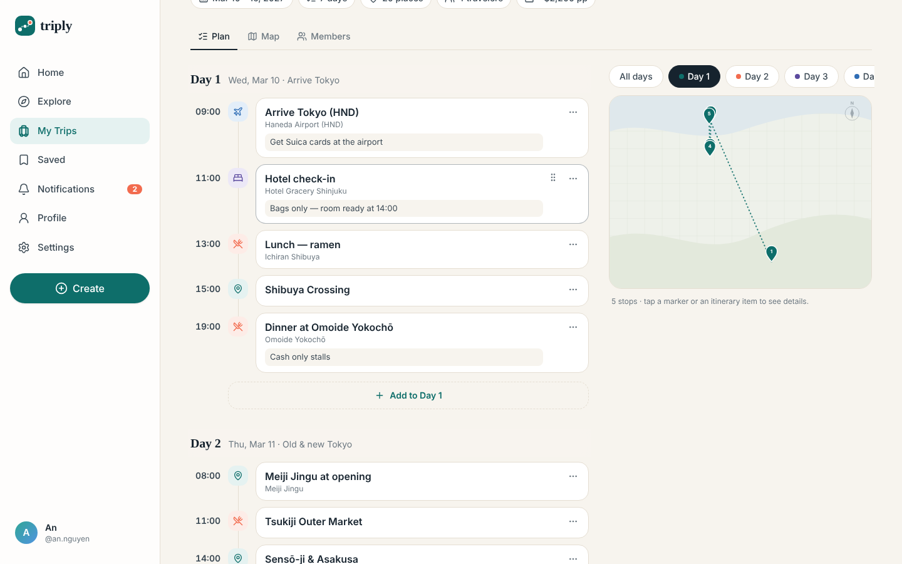
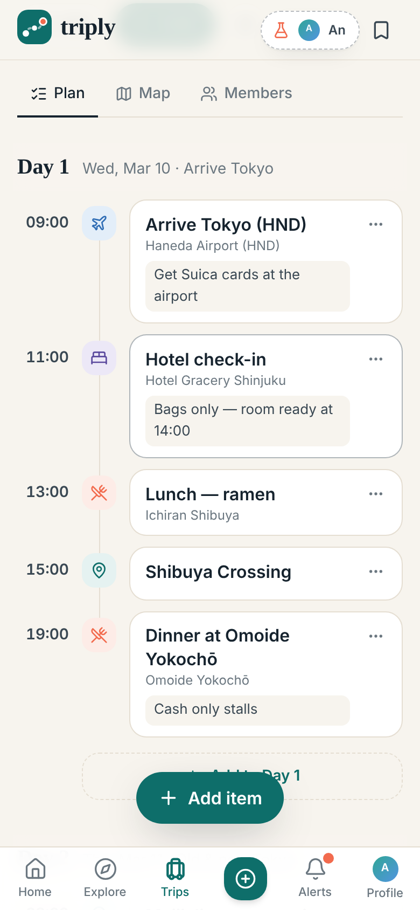
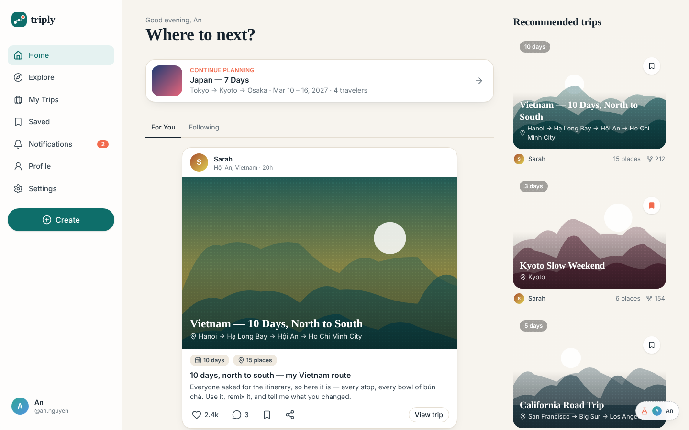
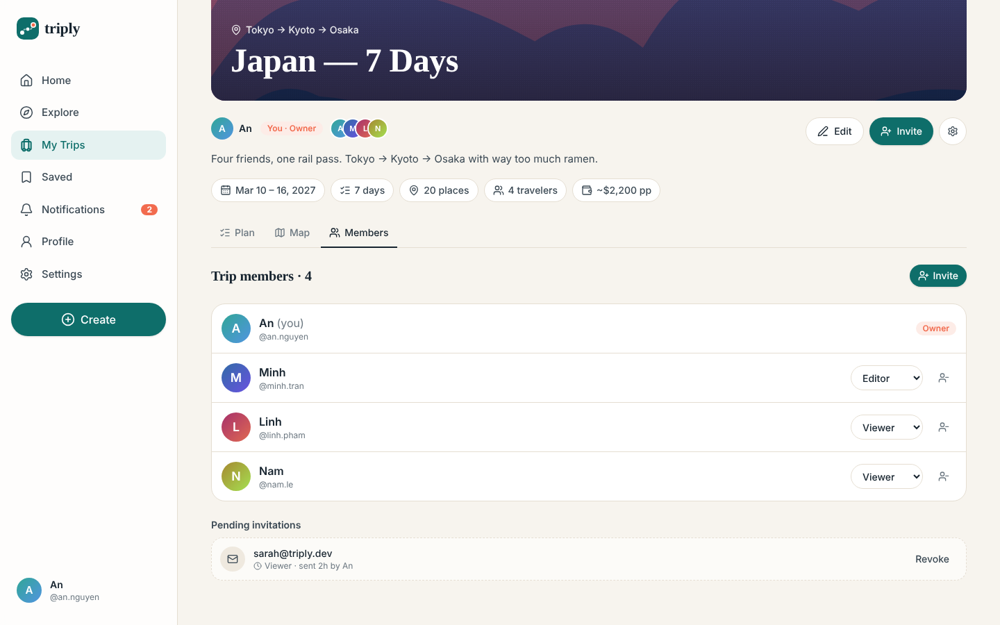
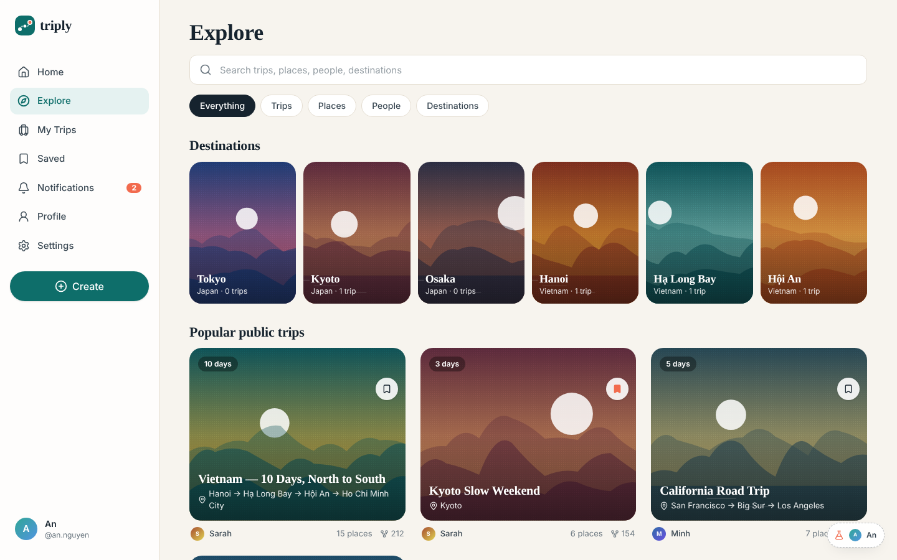
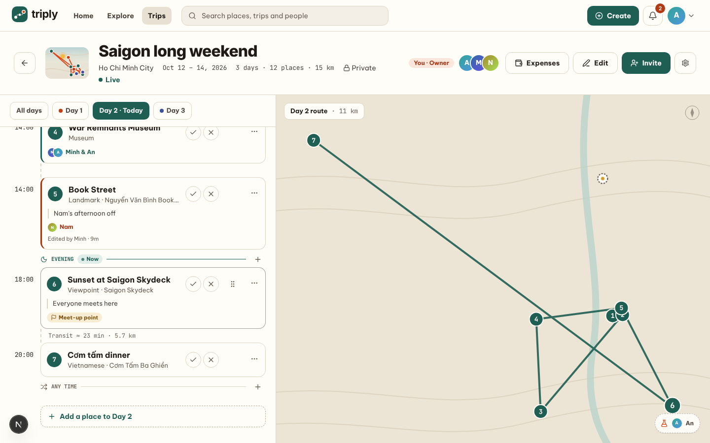
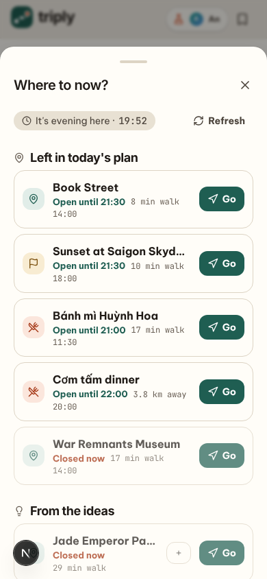
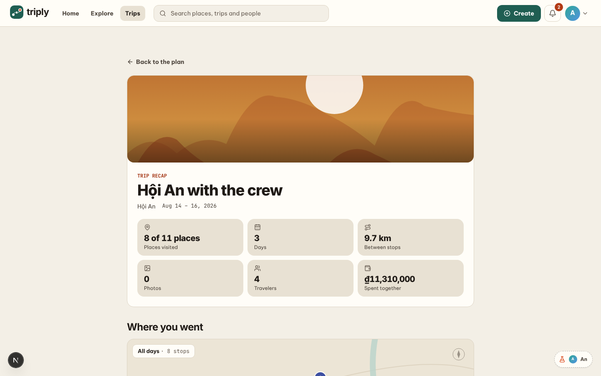
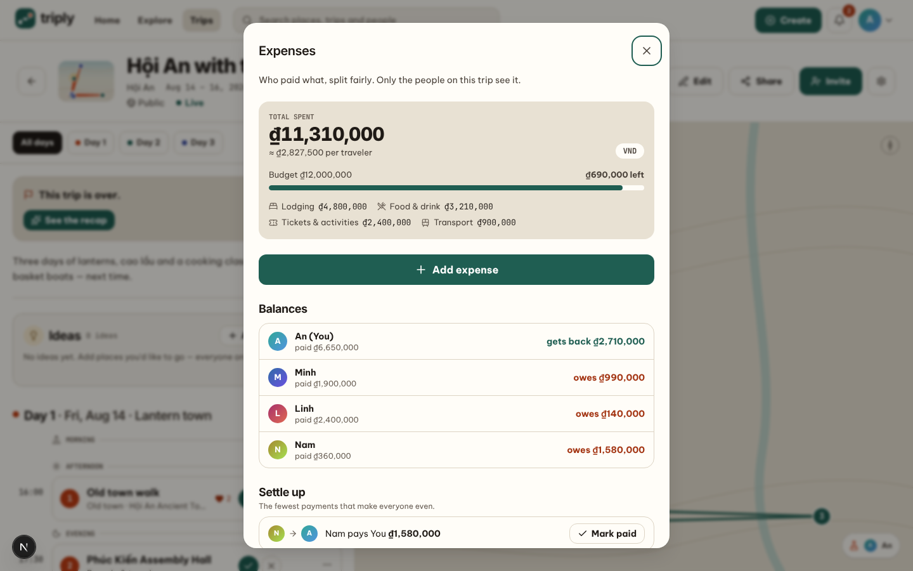
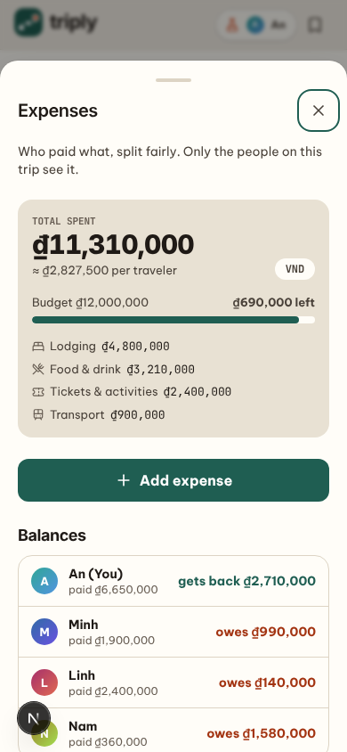

# Golaly

> **Plan together. Discover together. Travel together.**
> A social travel planning platform that turns real travelers' trips into reusable, collaborative travel plans.

Golaly is a full-stack MVP. You can discover public trips, remix one into your own plan in a single tap, invite friends as Editors or Viewers, edit the itinerary together with live updates, and share finished trips as posts.

**Discover → Save → Fork/Remix → Plan → Invite → Collaborate → Share**

| Desktop: itinerary + map | Mobile: itinerary |
|---|---|
|  |  |

| Home feed | Members & roles | Explore |
|---|---|---|
|  |  |  |

| During the trip: today, now, split group | Where to now? (mobile) |
|---|---|
|  |  |

| After the trip: recap | Shared expenses | Expenses on mobile |
|---|---|---|
|  |  |  |

---

## Stack

| Layer | Tech |
|---|---|
| Web | Next.js 16 (App Router), React 19, Tailwind CSS 4, TanStack Query, Socket.IO client |
| API | NestJS 11 (modular), Prisma 7 (`prisma-client` generator + `pg` driver adapter), Socket.IO, argon2id, JWT in HTTP-only cookies |
| Database | PostgreSQL 16 + PostGIS |
| Place catalog | `pipelines/`: Python 3.12, DuckDB, pyosmium, Apache Airflow 3: imports open place data (Overture Maps, OpenStreetMap) per country/province |
| Analytics | `analytics/`: dbt (dbt-core 1.12, dbt-postgres) builds aggregate marts in Postgres nightly (GitHub Actions on the demo, Airflow locally) for the admin dashboard |
| Shared | `packages/shared`: domain types, the **permission matrix**, **Zod schemas** used by both API and forms, and the API response contract |
| Tests | Jest (unit + integration against a real Postgres test DB), Playwright (Definition-of-Done journey) |
| Ops | Docker Compose, Dockerfiles, GitHub Actions CI/CD (Neon → Render → Vercel) |

```
golaly/
├── apps/
│   ├── api/                  NestJS REST API + WebSocket gateway
│   │   ├── prisma/           schema.prisma · migrations/ · seed.ts (dev demo data)
│   │   ├── src/common/       auth guard, CSRF, error filter, presenters (DB → view models)
│   │   ├── src/modules/      auth · users · trips · itinerary · members · search · social
│   │   │                     notifications · media · realtime · mail · audit
│   │   └── test/             integration tests (auth, trips, collaboration, social, realtime, media)
│   └── web/                  Next.js app (proxies /api/v1 and /media to the API)
│       ├── src/app/          (auth)/… and (app)/… routes
│       ├── src/components/   ui · layout · trip · itinerary · map · social
│       ├── src/lib/          api client + query hooks · realtime · session · toast
│       └── e2e/              definition-of-done.cjs (Playwright)
├── packages/shared/          types · permissions · schemas · api-types · fixtures/ (cases shared with Python)
├── pipelines/                place catalog: golaly_catalog (Python) · dags/ (Airflow) · tests/
├── analytics/                dbt project: staging views → ephemeral intermediates → aggregate marts (see its README)
├── docs/                     ARCHITECTURE.md · screenshots
├── docker-compose.yml        PostGIS (dev) + optional full stack + optional Airflow
└── .github/workflows/       ci.yml: lint · tests · build · pipelines → deploy on main · e2e.yml (manual)
```

---

## Run it locally

You need **Node.js 20.9+** and **PostgreSQL 16**. Use Docker Desktop for Postgres, or install it natively.

### 1. Install & configure

```bash
npm install            # also builds packages/shared and generates the Prisma client
npm run setup          # creates apps/api/.env (with a random JWT secret) and apps/web/.env.local
```

### 2. Start PostgreSQL

**Option A, Docker (easiest):**
```bash
docker compose up -d db      # PostgreSQL + PostGIS; creates the `golaly` and `golaly_test` databases
```

**Option B, native Postgres** (Windows installer from postgresql.org with the **PostGIS** add-on from Stack Builder, or Homebrew/apt `postgis`). Then create a user and both databases, for example with `psql -U postgres`:
```sql
CREATE ROLE golaly WITH LOGIN PASSWORD 'golaly' CREATEDB;
CREATE DATABASE golaly OWNER golaly;
CREATE DATABASE golaly_test OWNER golaly;
-- PostGIS can only be enabled by a superuser; enabling it in template1 covers every database created later
-- (including the ones the test suites recreate).
\c template1
CREATE EXTENSION IF NOT EXISTS postgis;
\c golaly
CREATE EXTENSION IF NOT EXISTS postgis;
\c golaly_test
CREATE EXTENSION IF NOT EXISTS postgis;
```
If you use different credentials, edit `DATABASE_URL` / `TEST_DATABASE_URL` in `apps/api/.env`.

> **Upgrading an existing checkout?** The database image is now `postgis/postgis:16-3.4-alpine`. `docker compose up -d db` recreates the container on the new image and keeps your data volume; then run `npm run db:deploy`.

> **Port 5432 already taken** (e.g. a native Postgres is running)? Put `GOLALY_DB_PORT=5433` in a `.env` file next to `docker-compose.yml` and use `localhost:5433` in your `DATABASE_URL` / `TEST_DATABASE_URL`.

### 3. Create tables, load demo data, run

```bash
npm run db:deploy      # creates the tables from prisma/migrations (no prompts)
npm run db:seed        # DEV ONLY: WIPES users, trips, posts, places (incl. an imported catalog), then loads the demo
npm run dev            # API → http://localhost:4000   Web → http://localhost:3000
```

Already have data you want to keep (your own account, an imported catalog)? Add only the two demo trips instead —
"Saigon long weekend" (under way today: Today, Where to now?, split group) and "Hội An with the crew" (over: recap,
expenses in đồng, remix evidence). It touches nothing else, reuses catalog places with the same name nearby, and can be
re-run (only those two trips are replaced; Saigon's dates move to today):

```bash
npm run db:demo-trip -w @golaly/api                             # both, owner an@golaly.dev
npm run db:demo-trip -w @golaly/api -- --owner you@example.com  # owned by your own account
npm run db:demo-trip -w @golaly/api -- --trip hoian             # just one: saigon | hoian
```

Open **http://localhost:3000** and log in with a demo account (password `demo1234`):

| User | Email | Role in "Japan — 7 Days" |
|---|---|---|
| An | an@golaly.dev | **Owner** |
| Minh | minh@golaly.dev | Editor |
| Linh | linh@golaly.dev | Viewer |
| Nam | nam@golaly.dev | Viewer |
| Sarah | sarah@golaly.dev | Not a member (public trips only); has a pending invite |

In development, a **flask button** (top bar on mobile, bottom-right on desktop) does a real login as any demo user, so you can switch between Owner, Editor, Viewer and an outsider quickly. It's hidden in production builds.

**Live collaboration:** open a normal window as An and a private window as Minh, both on the Japan trip. Edit as Minh and An's view updates instantly. The trip header shows a **Live** badge.

Emails (invites, password resets) are written to `apps/api/storage/outbox/` in development, never to logs.

### Optional: Google sign-in

The "Continue with Google" button only appears when Google credentials are configured.

1. In [Google Cloud Console](https://console.cloud.google.com/apis/credentials) → **Create credentials → OAuth client ID** → type **Web application**.
2. Authorised redirect URI: `http://localhost:3000/api/v1/auth/google/callback` (in production: `https://<your-web-domain>/api/v1/auth/google/callback`).
3. Put the values in `apps/api/.env` and restart the API:
   ```bash
   GOOGLE_CLIENT_ID=xxxx.apps.googleusercontent.com
   GOOGLE_CLIENT_SECRET=xxxx
   ```

Google accounts are matched by Google's account id, then by **verified** email (so an existing email/password user gets Google linked to the same account). Google-only users can add a password later in **Settings**.

### Optional: the mobile app's sign-in and push (API side)

The app (`apps/mobile`, Expo) signs in through `/api/v1/auth/app/*`: the same accounts and rules as the web, but the
tokens come back in the body (the app keeps them in the phone's secure storage) and requests carry
`Authorization: Bearer …`. Refresh tokens rotate exactly like the web's.

```bash
# Native Google sign-in: the iOS client id, and the web client id Android uses (comma-separated)
GOOGLE_APP_CLIENT_IDS=xxxx-ios.apps.googleusercontent.com,xxxx-web.apps.googleusercontent.com
# Sign in with Apple (required by the App Store when Google sign-in is offered): the app's bundle id(s)
APPLE_CLIENT_IDS=com.golaly.app
# Push notifications through Expo's push service (devices register with PUT /api/v1/push/devices)
PUSH_DRIVER=expo
EXPO_ACCESS_TOKEN=          # only if "Enhanced push security" is on in the Expo project
```

Apple accounts link by verified email like Google's (Apple's private relay addresses count as verified). A phone
gets pushes only while the session that registered it is live: signing out, changing the password elsewhere or
deleting the account stops them.

### Optional: catalog admin

The demo account **an@golaly.dev** is an admin; it sees **Admin** in the account menu (avatar, top right) and in Settings. To make another
account an admin: `UPDATE users SET role = 'ADMIN' WHERE email = 'you@example.com';` then sign in again.

The admin screens read the database directly; starting a sync goes through Airflow, so run the pipeline profile
(`docker compose --profile pipelines up -d --build`, see [pipelines/README.md](pipelines/README.md)) and unpause the
`catalog_scheduler` DAG for scheduled jobs. API settings (`apps/api/.env`):

```bash
AIRFLOW_API_URL=http://localhost:8080   # default; where Airflow's API server listens
AIRFLOW_USERNAME=                       # only when Airflow isn't in "everyone is admin" mode (docker compose is)
AIRFLOW_PASSWORD=
CATALOG_REALTIME=on                     # live run progress on the admin screens (LISTEN sync_run)
```

### Map tiles

Trip maps use [MapLibre GL](https://maplibre.org) with the free [OpenFreeMap](https://openfreemap.org) Positron style (quiet greys, so day-coloured pins and routes stand out), so they need internet access. Set `NEXT_PUBLIC_MAP_STYLE_URL` in `apps/web/.env.local` to use another style (MapTiler, Stadia, your own), or `off` to always use the offline SVG map. If tiles fail to load (offline, no WebGL), the app falls back to the SVG map automatically.

**Directions** ("Directions from here" on a stop in the trip planner) draw the route from the viewer's position using [OpenRouteService](https://openrouteservice.org) (OpenStreetMap data; free key, 2,000 routes/day). Get a key at openrouteservice.org/dev and add `ORS_API_KEY=…` to `apps/api/.env`. The key stays on the API (`GET /api/v1/directions`, signed-in users, cached ~10 min). Without a key the planner still offers "Open in Google Maps", which starts from the device's location. Turn-by-turn guidance is handed off to Google Maps / Apple Maps.

### Testing on a phone

Stop `npm run dev`, then:

```bash
node scripts/dev-phone.mjs            # same Wi-Fi → open http://<this computer's IP>:3100 on the phone
node scripts/dev-phone.mjs --tunnel   # anywhere → a https://….trycloudflare.com address (4G works too)
```

The script starts the usual dev servers plus a small proxy on port 3100 that serves the web app and forwards
`/socket.io` to the API, so the phone needs a single address and live collaboration works. It prints the
addresses; open the same one on the computer too, or keep using `http://localhost:3000`.

- **Same Wi-Fi** is plain HTTP, so phone browsers block location (directions, "Near me"); everything else works.
  On Windows, allow Node.js on *Private networks* the first time. If the phone can't connect, the script lists
  the computer's other addresses — pick one with `--ip 192.168.x.x` (VPN / VirtualBox / WSL adapters are skipped).
- **`--tunnel`** uses a free [Cloudflare quick tunnel](https://developers.cloudflare.com/cloudflare-one/connections/connect-networks/do-more-with-tunnels/trycloudflare/)
  (no account). Install `cloudflared` once — Windows: `winget install --id Cloudflare.cloudflared`, macOS:
  `brew install cloudflared`. It's HTTPS, so location features work. The address changes every run, and anyone
  with it can reach your dev app while the script runs.
- Log in with email (or a demo account after `npm run db:seed`); Google sign-in only works on `localhost`, the
  redirect address registered with Google. Invite and email links point at the phone address while it runs.
- How it plugs in: Next.js only serves its dev server to hostnames in `allowedDevOrigins` (`DEV_ALLOWED_ORIGINS`),
  the API accepts the extra origins in `CORS_EXTRA_ORIGINS`, and `NEXT_PUBLIC_REALTIME_URL=auto` makes the socket
  use the page's own origin when it isn't the dev server on :3000.

### Useful commands

| Command | What it does |
|---|---|
| `npm run dev` | shared (watch) + API (watch) + web (hot reload) |
| `node scripts/dev-phone.mjs [--tunnel]` | The same, reachable from a phone (Wi-Fi, or HTTPS anywhere with `--tunnel`) — see above |
| `npm test` | API unit + integration tests (uses `TEST_DATABASE_URL`, rebuilt each run) |
| `npm run test:unit` | Unit tests only (no database needed) |
| `npm run e2e` | Playwright Definition-of-Done journey against a running stack |
| `npm run perf -w @golaly/api` | Times ~40 API calls against a running API with parameters from your own data; fails on a call over budget (300 ms, admin 800 ms) |
| `npm run typecheck` | TypeScript, strict, all packages |
| `npm run lint` | ESLint (typescript-eslint, React Hooks, Next.js rules) |
| `npm run build` / `npm start` | Production build / serve |
| `npm run db:deploy` | Apply committed migrations (first-time setup, CI, production) |
| `npm run db:migrate` | After you change `schema.prisma`: create + apply a new migration (`prisma migrate dev`, needs CREATEDB for its shadow database) |
| `npm run db:reset` | Drop, re-migrate and re-seed the dev DB |

---

## What's implemented (MVP P0 + P1)

| Area | Details |
|---|---|
| **Auth** | Register with **email confirmation**, login with **per-account lockout** (5 wrong passwords → 15 min for unknown browsers; the owner's own browsers keep a signed device cookie and can still sign in, so the lock can't be used to shut someone out; unknown addresses get the same answers), logout that ends the session **immediately** (every request re-checks the session), refresh-token rotation with **theft detection** (a replayed old token revokes the session; a same-moment multi-tab refresh is tolerated), forgot/reset password (single-use, 30-min tokens; logs out everywhere), onboarding, **Google sign-in** (authorization-code flow with PKCE + state, ID token verified; linking to an unconfirmed account removes its password and sessions), set/change password. |
| **Users** | Profile with traveler type, interests, trips / countries / followers / following stats, "Follows you" badge and follower lists, avatar upload, bio, home base, public trips & posts, account deletion (confirmed with password, or username for Google-only accounts; soft delete + anonymise). |
| **Trips** | CRUD, destinations (multi-stop route), dates that keep days in sync and **never silently delete plans**, cover upload, budget, visibility `PRIVATE` (default) / `LINK_ONLY` / `PUBLIC`, allow comments, allow fork, soft delete. |
| **Itinerary** | Flexible plans: each day is split into morning / afternoon / evening / any time, and only anchors (flights, tours, bookings) need a clock time (it sorts them chronologically within their part of the day). Days (add, rename, delete with renumbering — a deleted day's places go back to the ideas pool), items of 7 types, place search, notes, duplicate, reorder within or across days and parts of the day (drag & drop or a keyboard-accessible menu), "Edited by …" trail. Concurrent edits to one trip are serialised with a row lock, so two people reordering at once can't undo each other. |
| **Ideas pool & group votes** | A shared pool of places the group wants to fit in somewhere: anyone who can edit adds ideas (also from any place page), every member — viewers included — votes *really want / fine / skip*, and the pool ranks by the group's score. Ideas close together are grouped into areas ("Near Kiyomizu-dera · 3") that can be planned into one part of a day at once; ideas show on the map as hollow pins. Members set the dates they're there for; the day bar shows who's away and the planner warns when someone who loves a place won't be there the day it's planned. |
| **During the trip** | While a trip is under way the planner **opens on today**, marks the part of the day it is **now**, and shows each day's progress. On phones a stop can be **swiped** right (went) or left (skipped). **"Where to now?"** takes one location fix and lists what's left of today's plan and the ideas — open places first, nearest first, with a walk estimate, "open until 17:30" from the place's opening hours, and a one-tap hand-off to Google / Apple Maps — plus well-rated places open nearby that aren't in the trip (one tap adds them to now). The group can **split up**: each stop can say who's going, a part of the day shows one colour per group, and one stop is the **meet-up point**. **Offline:** a service worker keeps the last copy of trip pages and data, and went/skipped marks made without a connection are kept on the device and synced when it's back. |
| **After the trip** | Once a trip starts, every stop gets one-tap **went ✓ / skipped ✕** buttons; when it's over the planner asks the group to mark what they did (a checklist that saves in one request). The **recap** (`/trips/:id/recap`) shows the places visited on a map and day by day with everyone's **photos of stops**, the stops the group loved most, the stamps the trip earned and a "Share as a post" shortcut. Trip cards show how it went ("Went · 8/11"), the profile passport only stamps trips that happened, and a **remix shows evidence** from the original group on each stop ("The original group went · 3 hearts") while the original stays viewable. |
| **Shared expenses** | Members only (never public): who paid what, split **equally** (leftover đồng/cents go to the first people, so shares always add up) or **by amount**, with category, day and an optional stop. Balances, the **fewest repayments to settle up** with "Mark paid" (undoable), totals by category and day, and the trip budget bar. One currency per trip — VND by default for Vietnamese users, USD otherwise — fixed once money is recorded; amounts are stored as integers in the currency's minor units. |
| **Collaboration** | Owner / Editor / Viewer enforced **server-side on every request**. Invite by email (bound to that address, single-use, and only claimable once the address is confirmed) or link (reusable until expiry/revoke). Tokens are 256-bit, stored as SHA-256 hashes, expire in 7 days and are revocable. Owners change roles and remove members; members can leave. Audit log for every permission change. |
| **Realtime** | Socket.IO rooms per trip (handshake checks the live session; joining re-checks permission). Item, day and member events refresh collaborators' screens; presence shows who has the trip open and which day they are editing ("Minh is editing Day 2"); removed members are kicked, outsiders are evicted when a trip goes private, revoked sessions are disconnected. Notifications are pushed live — only after their transaction commits. The client refreshes its session and reconnects on its own. |
| **Fork / Remix** | Copies title, description, dates, destinations, days, items and places. Does **not** copy members, invites, comments, media or counters. New owner = forker; copy starts Private; "Based on … by @…" attribution survives even if the source is deleted. |
| **Social** | Feed (For You / Following), cursor pagination on every list that can grow (trips, saved, comments, notifications), posts linked to trips (public post of a private trip is refused), drafts, photos, likes and saves that are idempotent under double-clicks, comments (author can moderate), follows, share, reports (5 reasons, one per user per target). |
| **Discovery** | Search across trips, places, people and destinations, with **suggestions as you type** in the navbar: **accent-insensitive and typo-tolerant** (`hoi an` → Hội An, `tokio` → Tokyo) using `pg_trgm` trigram indexes, every word must match, best matches first (behind a `SearchProvider` interface, so it can move to OpenSearch/Algolia later), destination pages (a map of what's there), explore led by a **map of destinations** sized by how many trips go there, recent searches. Home opens on **the trip that matters today** (under way: the next stop and "Where to now?"; coming up: a countdown; just back: mark it or see the recap). Place pages say whether a place is **open now in its own local time**, show the week's hours and how many public trips went there; Explore → Places can show only what's open now. Interactive **MapLibre** trip maps with numbered pins and the day's route. |
| **Explore places** | Browse places **around a destination or "Near me"** (browser location) within 2–25 km, by kind (10 groups such as Food, Coffee & drinks, Sights, Nature, Nightlife, and 50+ sub-categories with live counts), sorted by recommended / nearest / top rated, as a list and a map; filters live in the URL so results can be shared. Every place has its own page (hours, phone, website, names in other languages, directions, nearby places, public trips that include it, data credits). **Add to trip** from anywhere: pick one of the trips you can edit (nearby trips first), a day and an optional time, or create a new trip on the spot. |
| **Place photos** | A gallery on every place page and thumbnails in lists, from two sources: **travelers** (add a photo on the place page, or share a post's photos to the places of its trip) and **Wikimedia Commons** (openly licensed photos found through Wikidata per province by the catalog pipeline). Every photo carries the credit its licence requires. New accounts' photos and loose matches wait in a **moderation queue** (`/admin/photos`); three separate reports hide a photo until a moderator looks at it. Imported images are downloaded once into Golaly's own storage (three WebP sizes) by a background worker that can only fetch from allow-listed hosts. |
| **Privacy** | Private trips never appear in Explore, search, feeds or public profiles. Non-members of public trips don't see the member list or invites. Posts about a trip that goes private leave feeds and hide that trip everywhere (spec §34); remixes stop linking to it. Reports can't be used to probe for private content. |
| **Media** | JPEG/PNG/WebP validated by content, size and dimensions; re-encoded to WebP (**strips EXIF/GPS**) in three sizes (640 / 1280 / 2400px) served with `srcset`, plus a dominant-colour placeholder while loading. Uploads are capped at 40 MP, 30/min and 200/day per user; a photo removed from the app is deleted from storage too (and a sweep clears uploads nothing shows any more). Stored on local disk or, with `MEDIA_DRIVER=s3`, in an S3-compatible bucket such as Cloudflare R2. |
| **Notifications** | All 9 spec types, unread badge, mark one or all as read, deep links, coalescing of rapid item edits. |
| **Security** | argon2id; HTTP-only SameSite=Lax cookies; CSRF header check; typed JWTs (an OAuth state token can't pass as an access token); CORS locked to the web origin; Helmet on the API and anti-clickjacking headers on the web app; per-IP rate limits that can't be dodged by forging `X-Forwarded-For` behind the edge proxy; Content Security Policy (connections only to our origin, the realtime API and map tiles); passwords checked against common lists and, via k-anonymity, Have I Been Pwned; per-account daily limits on posts, comments and reports; validated env (refuses insecure cookies, short JWT secrets or a missing `NODE_ENV` in production); friendly error filter (no stack traces or SQL leak); no passwords, tokens or bodies in logs. |
| **Observability** | `Server-Timing` on every API response (total, database time, query count), slow-request log, and an admin view of p50 / p95 per route — enough to tell a slow query from slow code without a third-party APM. |
| **Accessibility** | WCAG AA colour contrast, focus-trapped dialogs that return focus, ARIA tabs and menus with arrow-key support, labelled and described form errors, skip link, one `<title>` per page, logical headings, 44px touch targets. An axe-core gate in the E2E run fails the build on any serious/critical issue (desktop and mobile). |

| **Place catalog** | Admin-driven import of places for a whole country, a province or one destination from **open data** (Overture Maps + OpenStreetMap), Python + Airflow. Records from every source are kept, matched across sources (names in any language, within 50 m) and merged field by field with recorded provenance; existing place ids and itineraries never change; re-runs are idempotent; closures need 3 missed runs and a safety brake stops mass closures. PostGIS boundaries per country (Vietnam's 34 provinces, or any country Overture covers); names per language for locale-aware display; duplicates scored across sources (auto-merge ≥ 0.85, review queue below that, exact undo). See **[pipelines/README.md](pipelines/README.md)**. |
| **Admin analytics** | `/admin/analytics`: headline numbers with the previous period (new and active people, trips created, % planned together, trips that started), daily sign-ups and active people, the activation funnel of the period's sign-ups, where new trips go, catalog health and security signals (lockouts, refresh-token reuse), live from the app tables with a 5-minute cache. Below it, **cohorts & stickiness** from the nightly dbt marts: DAU ÷ MAU, weekly retention heat table, activation by sign-up week. Aggregates only, cohorts under 5 people left out, server-side product events (no client tracker), every view audit-logged. Hand-drawn SVG charts with keyboard crosshair and table views. |
| **Catalog admin** | `/admin` for ADMIN accounts: **areas** with place counts and *Sync now* / *Dry run*; **sync jobs** on a cron schedule (an Airflow `catalog_scheduler` DAG starts the due ones; never two runs of a job at once); **runs** with live progress over Socket.IO, resumable after a crash (per-batch cursors), (Postgres `NOTIFY` → API → admin room), quality warnings, record-level errors and cancel; **duplicate review** side by side with merge / reject / undo; a **place editor** whose edits lock fields against imports (with history and unlock); **category mapping** for source categories that aren't published yet. Every action is checked against the database role and audit-logged. |

Not in this MVP (spec P2): AI planning, route optimisation, bookings, expense splitting, offline mode, live tracking.

API reference, data model and design decisions are in **[docs/ARCHITECTURE.md](docs/ARCHITECTURE.md)**.

The visual language ("Atlas": map-first, paper + jade + vermilion, a colour per day, mono for times and distances, with an "Atlas Night" dark mode) is specified in **[design-system/golaly/MASTER.md](design-system/golaly/MASTER.md)**. The interface is in **English and Vietnamese** — how languages are chosen and how to add copy: **[apps/web/src/i18n/README.md](apps/web/src/i18n/README.md)**.

---

## Performance at catalog scale

Measured with `npm run perf` on a synthetic catalog the size of a real one (`apps/api/perf/synthetic.sql`: 1.8M places
in 3 countries, 1.95M source records, Vietnamese names with diacritics, almost no ratings), PostgreSQL 16 with
default settings. Median of 5 warm runs:

| Call | Before | After |
|---|---|---|
| Explore home | 1,442 ms | 34 ms |
| Browse a province / a country / everywhere | 1,195–2,335 ms | 22–38 ms |
| Text search ("pho", 119k matches) | 3,499 ms | 108 ms |
| Text search with a typo | 31,108 ms | 172 ms |
| Itinerary place search | 2,055 ms | 132 ms |
| Admin: provinces / places / categories | 18,793 / 7,079 / 13,667 ms | 13 / 14 / 190 ms |
| **Within budget** | **13 / 38** | **38 / 38** |

On a real catalog (1.85M places from Overture + OpenStreetMap in Japan, France, China, Vietnam and Switzerland;
Tokyo alone 148k) the same run found two things synthetic data couldn't show: a place page in a dense city (the
"nearby" list sorted every place within 1.5 km — now a KNN walk of the GIST index: 383 → ~40 ms) and the unmapped
categories screen (it read the jsonb of millions of OSM records: 21 s → a background summary read in ~15 ms,
recounted by `catalog_scheduler` after syncs or with the Recount button). With those fixed, 38 / 38.

What made the difference: indexes that match each list's ORDER BY (so the first page is read in order instead of
sorting a province), `status` as an index column because Prisma's enum casts defeat partial-index predicates, counts
as one index-only `GROUP BY` (cached for whole areas) instead of a count per row, no Prisma `_count` on big relations
(it aggregates the whole related table), fuzzy matching through the indexable `<%` operator and only when nothing
matches exactly, and ranking a broad text query on a bounded set of candidates (plus every place whose name starts
with the query) — the total then shows as "1,500+" — and keeping the planner on the indexes for those candidate
queries (`SET LOCAL enable_seqscan = off`: it underestimates `<%`, and a typo matching nothing would otherwise read
every row).

---

## Testing

- **Unit** (`src/**/*.spec.ts`): the permission matrix and `TripAccessService`, itinerary ordering logic (parts of the day, anchors, area grouping, group scores, members' dates), crypto, dates and the shared Zod schemas.
- **Integration** (`test/*.int.ts`): boots the real Nest app against `golaly_test`, rebuilt from the committed migrations and seeded. Covers auth (cookies, rotation, CSRF, reset, deletion), trip and itinerary services, invitations (link, email-bound, expiry, revoke), roles, fork rules, realtime events over a real socket, social, privacy, reports and media uploads. `during-trip.int.ts` covers phase 2: "Where to now?" ranking (open before closed, today's plan by part of the day, nearest first), nearby suggestions (rated, open, not in the trip), access and input checks, who's going (members only, everyone = nobody singled out, cleared when someone leaves, not copied by a remix) and the meet-up point; `opening-hours.spec.ts` covers the opening-hours evaluator. `after-trip.int.ts` covers phase 3: batch statuses and the trip's outcome, stop photos and who may remove them, remix evidence (hidden once the original goes private), and expenses — equal and by-amount splits, balances and settle-up, members-only access, edit rules, the currency lock and Vietnamese errors. `plans.int.ts` covers flexible plans: the ideas pool, parts of the day and anchors, moves between pool and days, votes (viewers included), members' dates, forks copying ideas without votes, and the activity log (facts only, consent opt-in). `hardening.int.ts` covers the security/concurrency fixes: immediate logout, lockout, email confirmation, Google takeover of a squatted account, refresh-token theft detection, concurrent comment deletes / likes / reorders, socket handshake and eviction, pagination and input validation.
- **E2E** (`apps/web/e2e/definition-of-done.cjs`): runs the spec §51 journey in three separate browser sessions: register → create trip → 3 items → invite → accept → promote to Editor → editor edits → owner sees it live → make public → another user discovers, saves and forks → fork is independent → original unchanged → attribution kept → explores food around Tokyo, opens a place and adds it to Day 2 of the trip → another traveler adds a photo to that place → an admin creates, pauses and deletes a sync job and every admin screen passes axe, plus a privacy check, an **axe-core accessibility gate** (11 screens incl. Explore places, a destination and a place page, at desktop and mobile widths; also fails on sideways scrolling) and cleanup of the trips it created.

Also `npm run lint` (ESLint 9 with typescript-eslint, React Hooks and Next rules) runs in CI.

- **Pipeline** (`pipelines/tests`, pytest): normalisation (checked against the same cases as the TypeScript `normalizeSearch`), provider adapters, and end-to-end runs on synthetic Overture/OSM fixtures against a real PostGIS database: idempotent re-runs, itineraries untouched, locked fields, closures and the safety brake. The Airflow DAGs were executed with `dag.test()` on Airflow 3.1.

Current status: **146/146** API tests (`admin.int.ts` covers the catalog admin API: admin-only access, job validation and lifecycle, runs started through a mocked Airflow, Airflow being down, cancel, merge / reject / undo, place edits that lock and unlock fields, category mapping, and the NOTIFY → socket hand-over; `photos.int.ts` covers trust and review, sharing from posts, reports, moderation, the importer's host allow-list and back-off; `places.int.ts` covers the taxonomy, browsing by area/radius/kind/text, paging, input validation, closed/merged/hidden places, privacy of trips shown on a place, and who may add to which trip), **122** pipeline tests (`test_resume.py` interrupts a sync mid-partition, resumes it and checks the result is identical to an uninterrupted run on a twin database) (+ DAG tests that run where Airflow is installed), lint clean, and **all Definition-of-Done steps + the accessibility gate** pass.

---

## Deploying

**Continuous delivery:** every push to `main` that passes CI runs the Neon migrations, deploys the API to Render and the web app to Vercel, then smoke-tests both. Setup and rollback: [docs/CI-CD.md](docs/CI-CD.md).

The repo has a Dockerfile for each app and a `full` Compose profile:

```bash
export JWT_SECRET=$(node -e "console.log(require('crypto').randomBytes(48).toString('base64url'))")
docker compose --profile full up --build      # → http://localhost:3000
```

Services: `db` (bound to 127.0.0.1 only) → `migrate` (runs `prisma migrate deploy` once) → `api` → `web` → `edge` (nginx, the only published port). The edge overwrites `X-Forwarded-For` with the real client address, so per-IP rate limits can't be bypassed, and it serves Socket.IO on the same origin, so the API port is never exposed. Images are small and run as the unprivileged `node` user (Next.js `standalone` output, production-only dependencies).

For a real deployment (for example Render, Railway or Fly for the API, Vercel for the web app, and a managed Postgres):

1. **API**: set `DATABASE_URL`, `JWT_SECRET` (48+ random bytes), `WEB_ORIGIN=https://your-web-domain`, `COOKIE_SECURE=true` (the API refuses to start in production without it), `NODE_ENV=production` and `TRUST_PROXY` (the subnet or hop count of the proxies in front — never `true`). Run `npm run db:deploy` on release, then `node apps/api/dist/main.js`.
2. **Web**: set `API_ORIGIN=https://your-api-domain` **at build time** (Next rewrites are compiled in) and `NEXT_PUBLIC_REALTIME_URL=https://your-api-domain`.
3. The web app and the API can live on different domains (e.g. `*.vercel.app` and `*.onrender.com`): HTTP goes through the web app's rewrites with the cookie, and the realtime socket authenticates with a one-minute token fetched the same way (see `docs/ARCHITECTURE.md` → WebSocket). Serving both under one parent domain (`app.example.com` + `api.example.com`) or behind one reverse proxy like `deploy/nginx.conf` also works.
4. **Client IPs:** set the same random `EDGE_SECRET` (32+ characters, e.g. `openssl rand -hex 32`) on the API and on the web app's runtime env (Vercel → Settings → Environment Variables, Production). The web proxy then hands the API each visitor's real address with that secret, so per-IP limits apply per visitor instead of per web server; anything without the secret is ignored. Check it as an admin at `/api/v1/admin/diagnostics/request` (`viaEdge: true`). Behind your own nginx, also overwrite `X-Forwarded-For` (`proxy_set_header X-Forwarded-For $remote_addr`). In plain `npm run dev` there's no edge — per-account login lockout still applies.
5. **Media on a host without a disk** (Render Free, Fly without a volume): use an S3-compatible bucket — see [Media in a bucket](#media-in-a-bucket-cloudflare-r2) below. Send real mail with `MAIL_DRIVER=smtp` — see [Email](#email) below.
6. Never run `db:seed` in production. It refuses when `NODE_ENV=production`.

> The Compose file and nginx config were validated (`docker compose config`, `nginx -t`, and the edge was exercised against the running stack), but the images themselves couldn't be built where this was developed (no Docker Hub access). Run `docker compose --profile full up --build` once on your machine.

### Media in a bucket (Cloudflare R2)

`MEDIA_DRIVER=s3` stores uploads (and imported catalog photos) in any S3-compatible bucket — Cloudflare R2, Backblaze B2, MinIO or AWS S3 — through a dependency-free Signature V4 client (`apps/api/src/modules/media/s3.ts`, checked against AWS's published test vector and an in-process S3 stand-in in `test/media-s3.int.ts`). Image URLs don't change: they stay `/media/<key>` on the web's origin, so the offline service worker can still cache them.

1. **Cloudflare → R2 → Create bucket** (e.g. `golaly-media`). Under **Settings → Public access** enable the `r2.dev` subdomain (or connect a custom domain) — that URL is `MEDIA_PUBLIC_URL`.
2. **R2 → Manage API tokens → Create token** with *Object Read & Write* on that bucket. Note the access key ID, secret, and the S3 endpoint `https://<account id>.r2.cloudflarestorage.com`.
3. **API** env: `MEDIA_DRIVER=s3`, `S3_ENDPOINT`, `S3_REGION=auto`, `S3_BUCKET`, `S3_ACCESS_KEY_ID`, `S3_SECRET_ACCESS_KEY`, `MEDIA_PUBLIC_URL`. The API refuses to start if one is missing. `/media/*` requests that reach the API are 301-redirected to the bucket.
4. **Web** env: `MEDIA_ORIGIN` = the same public URL, then redeploy (rewrites are build-time). Next.js then proxies `/media/*` straight to the bucket, skipping the API.
5. **Existing files** (e.g. after `npm run data:import`): put the S3 variables in `apps/api/.env` and run `npm run build -w @golaly/api && npm run media:push -w @golaly/api -- --dry-run`, then without `--dry-run`. Keys are kept; objects already in the bucket are skipped.
6. With a durable bucket you can turn the catalog photo worker back on (`PHOTO_INGEST=on`, `CATALOG_CONTACT=<url or email>`).

### Email

Sign-up verification, password reset and trip invitations need real mail in production. `MAIL_DRIVER=smtp` sends through any SMTP provider with a dependency-free client (`apps/api/src/modules/mail/smtp.ts`: implicit TLS or STARTTLS, AUTH PLAIN, UTF-8 subjects; tested against an in-process server in `smtp.spec.ts`). Mail goes out after the request has answered, one at a time, with retries on temporary failures — a slow or broken mail server never blocks sign-up. Recipients and bodies are never logged.

1. **Pick a sender.** Without a domain of your own, a Gmail account works: turn on 2-Step Verification, then create an *App password* (Google Account → Security → App passwords). Gmail limits how many messages an account sends per day; for more volume or your own domain use a provider such as Brevo, Amazon SES or Resend (each documents its SMTP host and credentials).
2. **API** env: `MAIL_DRIVER=smtp`, `SMTP_URL=smtps://you%40gmail.com:<app password without spaces>@smtp.gmail.com:465` (URL-encode `@` and other special characters in the user name and password), `MAIL_FROM=Golaly <you@gmail.com>`. The API refuses to start if one is missing.
3. **The host must allow outgoing SMTP.** Render's Free web services block ports 25, 465 and 587; a paid instance doesn't. Check your host's policy if mail never arrives (the API logs `"<subject>" not sent: …`).

---

## Presenting this in a portfolio

- **Lead with the loop:** a 30-second recording of *Sarah remixes An's public trip → edits her copy → An's original is untouched* explains the product immediately.
- **Show authorization as a feature:** put `packages/shared/src/permissions.ts` and `TripAccessService` next to Owner, Editor and Viewer screenshots. Every write is re-checked server-side with roles from the database.
- **Show one schema, two runtimes:** the same Zod schemas validate the forms and the API.
- **Show the data platform:** `pipelines/` is a small, real ETL: Overture GeoParquet read straight from S3 with DuckDB, OSM streamed with pyosmium, PostGIS, idempotent upserts by content hash, cross-source entity matching, field-level survivorship with provenance, and an Airflow DAG with one mapped task per province.
- **Show the analytics engineering:** `analytics/` is a dbt project on the app's own Postgres: server-side product events → staging views → ephemeral per-person intermediates → aggregate marts (DAU/WAU/MAU, weekly retention cohorts, activation within 30 days), with data tests that also enforce privacy (no person-level columns in marts, no cohort under 5). It runs nightly from GitHub Actions and Airflow, is checked in CI, and feeds `/admin/analytics`. Seed it with `npm run db:analytics-demo -w @golaly/api` for screenshots and the lineage graph (`dbt docs`).
- **Show the operator side:** the admin console turns the pipeline into a product: schedule a country, watch its run progress live, review duplicates side by side, fix a place by hand and see the field stay locked through the next import.
- **Show the performance work:** the before/after table above, made reproducible by `perf/synthetic.sql` + `npm run perf`. It's a measured story: a 31-second typo search down to 170 ms, and why (EXPLAIN plans, Prisma's enum casts vs partial indexes, `_count` aggregating a 2M-row table).
- **Show Explore as a product loop:** *"near me" → coffee → open a café → Add to trip → Day 2* in 15 seconds, then the same place appearing on the trip map. The category facets and PostGIS radius query sit behind it.
- **Show the photo strategy:** no app "collects every photo". Golaly layers traveler uploads (with trust, review and reports), open Commons photos (licence-filtered, credited, matched through Wikidata/OSM) and, later, a paid provider shown live; one `place_photos` table, one ranking, one credit line.
- **Point to the tests:** 146 API tests plus a Playwright script that proves the spec's Definition of Done and gates accessibility.
- **Tell the hardening story:** honest self-reviews found a rate-limit bypass, Google account pre-hijacking and race conditions, then (after deploying) an open redirect, a removed member rejoining through an old link, collaborator identities leaking on public trips, cross-site WebSocket hijacking and socket flooding; each fix landed with a test that reproduces the problem (`apps/api/test/hardening.int.ts`, `apps/api/test/security.int.ts`). Interviewers love this.
- **Suggested headline:** *"Golaly: collaborative trip planning with GitHub-style fork/remix for itineraries. Next.js 16 · NestJS · Prisma · PostgreSQL · Socket.IO."*
