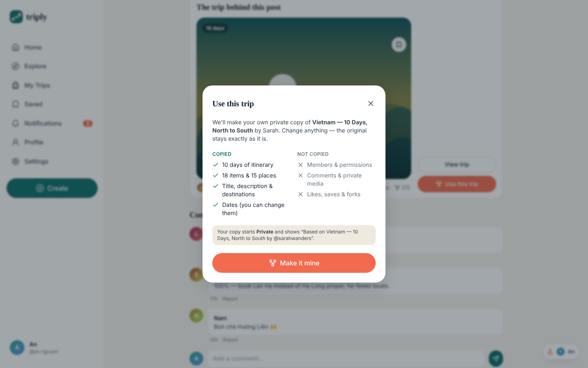

# TRIPLY — clickable UI prototype

> **Plan together. Discover together. Travel together.**
> A social travel planning platform that turns real travelers' trips into reusable, collaborative plans.

This repo is the **front-end prototype** of the TRIPLY MVP. It's a real Next.js app with every core screen wired up, so you can click through the whole product loop before any backend exists:

**Discover → Save → Fork/Remix → Plan → Invite → Collaborate → Share**

The data layer is an in-browser **mock API** that follows the same rules the planned NestJS + PostgreSQL backend will enforce (roles, privacy, fork rules, validation). When the backend is built, screens keep calling the same `actions.*` functions, and only the function bodies switch to `fetch('/api/v1/...')`.

| Desktop — trip planning | Mobile — itinerary |
|---|---|
|  |  |

| Home feed | Fork / "Use this trip" | Explore |
|---|---|---|
|  |  |  |

---

## Quick start

Requirements: **Node.js 20.9 or newer** (`node -v`).

```bash
cd triply
npm install
npm run dev
```

Open **http://localhost:3000**. You start signed in as **An** (owner of the private "Japan — 7 Days" trip).

| Command | What it does |
|---|---|
| `npm run dev` | Dev server with hot reload |
| `npm run build && npm start` | Production build and server |
| `npm run typecheck` | TypeScript, strict mode |

### Demo accounts

All passwords are `demo1234`. **Demo data is for development only.**

| User | Email | Role in "Japan — 7 Days" |
|---|---|---|
| An | an@triply.dev | **Owner** |
| Minh | minh@triply.dev | Editor |
| Linh | linh@triply.dev | Viewer |
| Nam | nam@triply.dev | Viewer |
| Sarah | sarah@triply.dev | Not a member (sees only public trips) |

**The flask button** (bottom-right on desktop, top bar on mobile) is a prototype-only tool. Use it to switch users instantly, log out, or reset the demo data.

**Live collaboration demo:** open two browser tabs and pick a different user in each, for example An and Minh. When the editor changes the itinerary, the owner's tab updates without a reload. This stands in for the planned WebSocket events.

---

## 3-minute demo script (the MVP "Definition of Done")

1. **As An:** go to *My Trips → Japan — 7 Days*. Add an item with **Add to Day 1**: pick a type, search a place, and the title fills in for you.
2. Click **Invite**, choose *Invite link* + *Viewer*, and copy the link.
3. **Switch to Minh** (flask). He's an Editor, so he can edit, duplicate, reorder (drag or ⋯ menu) and delete items. **Switch to Linh**: she's a Viewer, so every edit control disappears.
4. **As An:** open *Members* and change Linh to **Editor**, or remove Nam. Pending invites can be revoked.
5. Open **Settings** (⚙). Set visibility to **Public** and save.
6. **Switch to Sarah:** go to *Explore*, search "Japan", open the trip, click **Save**, then **Use this trip → Make it mine**.
7. Sarah now owns a **private copy** with the attribution "Based on Japan — 7 Days by @an.nguyen". Members weren't copied. Edit it, then switch back to An: the original hasn't changed.

The same journey runs as an automated script: see [Testing](#testing).

---

## What's in the prototype

| Area | Screens and behaviour |
|---|---|
| Auth | Splash, Welcome, Register (validated), Login, Forgot password (no account enumeration), 2-step Onboarding (traveler type + interests), Google button stub |
| Home | Continue-planning card, For You / Following feed, recommended trips, trending destinations |
| Explore | Search across Everything / Trips / Places / People / Destinations; destination pages (popular trips, trending places, recent posts, itineraries to remix) |
| Trip overview | Cover, route, dates, days, places, travelers, budget, your role; Edit / Invite / Share / Save / **Use this trip** shown based on permissions |
| Itinerary | Multi-day timeline; add / edit / duplicate / delete / reorder (drag & drop + menu); 7 item types; place search; notes; "Edited by Minh" trail; one-hand mobile **Add item** button |
| Map | Offline SVG map with numbered markers, route per day, day filter, selection synced with the itinerary; built behind a `MapAdapter` boundary so MapLibre/Mapbox can replace it later |
| Members | Owner/Editor/Viewer badges, role dropdown and remove (owner only), pending invites with revoke |
| Invitations | By email or by link; opaque 32-char tokens, 7-day expiry, revocable; accept/decline page with expired/revoked states |
| Trip settings | Name, description, dates, destinations, visibility (Private / Link-only / Public), allow comments, allow fork, delete (owner only) |
| Social | Post cards, post detail with photo pager, likes, comments, save, share (copy link), report (5 reasons), create post / draft linked to a trip |
| Profile | Stats, Follow, Trips/Posts tabs. **Private trips never appear on public profiles.** |
| Saved | Trips / Posts / Places tabs |
| Notifications | All 9 notification types, unread state, mark one or all as read, deep links (invites open the accept page) |
| Empty & error states | Friendly copy everywhere ("Your next adventure starts here.", "This trip is private.", "This invitation has expired.") |

### Rules the mock API enforces (same as the future backend)

- **Permissions** live in one place: `packages/shared/src/permissions.ts`. The UI uses `can()` to hide controls, and every mutation **checks again** inside the mock API, so editing from a stale tab fails with *"You no longer have permission to edit this trip."*
- **Privacy:** private trips are excluded from Explore, search, feeds and public profiles. Link-only trips are viewable but unlisted.
- **Fork contract:** copies title, description, dates, destinations, days, items and places. It does **not** copy members, invitations, comments or counters. The new owner is the person who forked, the copy starts Private, and attribution is stored. The source trip is never modified, except that its fork count goes up.
- **Validation:** emails, usernames, passwords, dates (end ≥ start), times, titles, comment length.
- **IDs:** UUID-shaped everywhere. Nothing sequential appears in URLs.

---

## Project structure

```
triply/
├── apps/web/                     Next.js 16 (App Router) + React 19 + Tailwind CSS 4
│   ├── src/app/
│   │   ├── (auth)/               welcome, login, register, forgot-password, onboarding
│   │   ├── (app)/                home, explore, explore/[slug], trips, trips/new,
│   │   │                         trips/[id], trips/[id]/settings, posts/new, posts/[id],
│   │   │                         u/[username], saved, notifications, settings, invite/[token]
│   │   ├── page.tsx              splash
│   │   └── globals.css           design tokens (@theme)
│   ├── src/components/
│   │   ├── ui/                   Button, Sheet (bottom sheet ↔ dialog), Tabs, Chip, Avatar, EmptyState…
│   │   ├── layout/               AppShell (sidebar + bottom nav), CreateSheet, DemoSwitcher, Toaster, Logo
│   │   ├── trip/                 TripCard, Cover art, MembersPanel, InviteSheet, ForkSheet, DestinationPicker
│   │   ├── itinerary/            Itinerary timeline, ItemSheet, type icons
│   │   ├── map/                  TripMap (MapAdapter boundary)
│   │   └── social/               PostCard, PlaceRow, ReportSheet
│   ├── src/lib/
│   │   ├── mock/                 seed.ts (demo data) · api.ts (mock endpoints) · selectors.ts (read rules)
│   │   ├── store/                React store + hooks (usePermissions, useTrip, useUnreadCount)
│   │   └── utils.ts
│   └── e2e/definition-of-done.cjs
├── packages/shared/              Domain types, permission matrix, labels (shared with the future API)
└── docs/screenshots/
```

### Moving from prototype to MVP

| Prototype piece | Becomes |
|---|---|
| `lib/mock/seed.ts` | `apps/api/prisma/seed.ts` |
| `lib/mock/api.ts` functions | NestJS module services (`trips`, `itinerary`, `members`, `invitations`, `posts`…) behind `/api/v1` |
| `packages/shared/permissions.ts` | Imported unchanged by NestJS guards and the web app |
| `lib/store/store.tsx` | Server state through TanStack Query or React Server Components; `actions.*` call the REST client |
| `storage` event sync | Socket.IO events: `trip.item.created/updated/deleted`, `trip.member.joined/role_changed` |
| Generated cover art | Object storage (S3/R2) with signed URLs and thumbnails |
| SVG `MapCanvas` | MapLibre GL with the same `TripMap` props |

---

## Design system

- **Palette:** warm *sand* canvas `#F7F4EE`, deep *lagoon* primary `#0E6E6A`, *sunset* accent `#F26B4E`, ink `#16232E`. Tokens are in `globals.css` under `@theme`.
- **Type:** a bookish serif for display text (postcards and travel journals) and the system sans for UI.
- **Signature motif:** generated "postcard" covers (sun, layered ridges, water), one per trip, so the prototype has its own identity without stock photos.
- **The 5-second rule:** every trip card shows destination, duration, creator, place count and cover without any interaction.
- **Mobile:** bottom navigation, bottom-sheet forms, a one-hand Add item button. **Desktop:** sidebar navigation, itinerary on the left with the map on the right.
- **Accessibility:** focus rings, labelled controls, `aria-pressed` and `aria-selected` states, Esc closes sheets, and reduced-motion is respected.

---

## Testing

The MVP journey from spec §51 is scripted: register → create trip → 3 items → invite → accept → promote to Editor → editor edits → owner sees the change live → make public → another user discovers, saves and forks → fork is independent → original is unchanged → private trip doesn't leak.

```bash
npm i -D playwright && npx playwright install chromium
npm run dev                                   # terminal 1
node apps/web/e2e/definition-of-done.cjs      # terminal 2 (BASE_URL=... to override)
```

All 12 checkpoints pass on the build in this repo, with no console errors.

---

## Known limits (on purpose for a prototype)

- Data lives in your browser's `localStorage`. Use *Reset demo data* to start over.
- No real auth, email, uploads or map tiles. Those buttons show a short "arrives in Week N" toast.
- Ownership transfer, Google OAuth, and AI suggestions are out of scope (P1/P2 in the spec).

## Next steps (from the 10-week plan)

1. **Week 1:** add `apps/api` (NestJS + Prisma + PostgreSQL), migrations generated from `packages/shared/types.ts`, JWT in HTTP-only cookies, CI.
2. **Weeks 3–5:** port `api.ts` module by module (trips → itinerary → members/invitations), with unit tests for the permission, fork and invitation services.
3. **Week 6:** Socket.IO gateway and MapLibre.
4. **Weeks 7–9:** posts and media storage, search behind a `SearchService`, notifications.

---

## Presenting this in a portfolio

- **Lead with the loop, not the stack.** A 30-second screen recording of *Sarah forks An's trip → edits → the original stays unchanged* shows the product idea immediately.
- **Show the permission matrix** (`packages/shared/src/permissions.ts`) next to the Owner, Editor and Viewer screenshots. It shows you think about authorization as a product feature.
- **Explain the prototype-to-MVP seam:** "screens only call `actions.*`; swapping the mock for REST touches one file per module." Reviewers look for this kind of architecture thinking.
- **Link the e2e script** as evidence that the Definition of Done is testable, not just a list of claims.
- Suggested headline: *"TRIPLY — collaborative trip planning with GitHub-style fork/remix for itineraries (Next.js 16, React 19, TypeScript, Tailwind 4)."*
